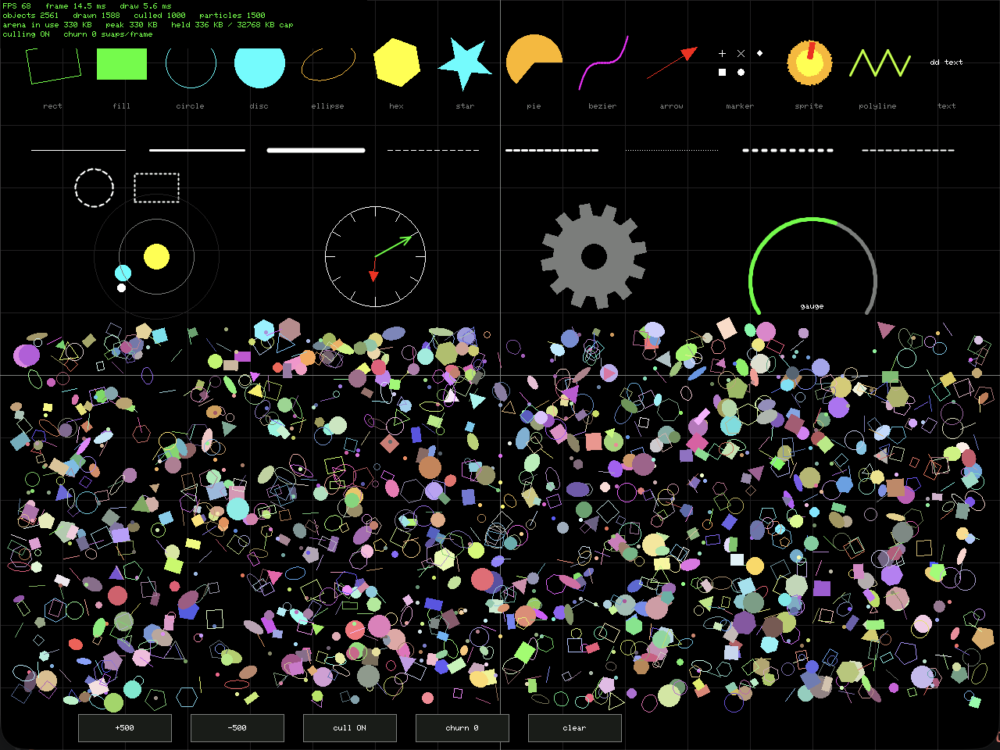

# dd



2D vector scenes, geometry and collision for [LovyanGFX](https://github.com/lovyan03/LovyanGFX), on ESP32 / RP2040-class microcontrollers and on the desktop (SDL).
Header-only, float-only maths (friendly to FPUs that have no double support), no heap churn in the drawing path.

| Header | What it does | Needs LovyanGFX |
|---|---|---|
| `ddPoint.h` | `ddP` (homogeneous 2D point), `Matrix3x3`, `ddT` (position / angle / scale transform) | no |
| `ddArena.h` | Chunked arena allocator with a hard byte cap, PSRAM-first on ESP32, per-object free | no |
| `ddGeom.h` | Collision and measurement maths on points, lines, circles and boxes (`ddBox`) | no |
| `ddShapeSet.h` | World-space collision geometry for shapes and the part-vs-part tests | no |
| `ddRender.h` | `ddR`: world to display mapping, pens (width / dashed / dotted), polygon fill, culling stats | yes |
| `ddVector.h` | Scene primitives and `RenderBlock` (the scene): picking, groups, culling | yes |
| `ddCollide.h` | Shape-to-shape collision between scene primitives | yes |
| `ddInteract.h` | Select / drag / tap on top of picking | yes |
| `ddSDLInput.h` | Desktop only: mouse mapped to the SDL panel's scaling, plus an aspect lock | yes (SDL) |
| `dd.h` | Includes everything except `ddSDLInput.h` | yes |

**Documentation:** [wiki pages](docs/wiki/Home.md) ([concepts](docs/wiki/Concepts.md), [collision guide](docs/wiki/Collision-Guide.md), [API reference](docs/wiki/API-Index.md)); every public class and function also carries a doc comment in `src/` that your IDE shows on hover.

## Install (PlatformIO)

```ini
lib_deps =
    lovyan03/LovyanGFX@^1.2.21
    https://github.com/JasonBolbach/dd.git
```

Working on dd itself next to a project (this is how it is developed): put the checkout beside your project and use
`lib_deps = symlink://../path/to/dd`, or add its parent folder to `lib_extra_dirs`.

## A first scene

```cpp
#include <LovyanGFX.hpp>
#include <dd.h>

LGFX_Sprite *spr;             // your display / sprite
ddR *r;
RenderBlock scene;            // owns an arena: grows on demand up to DD_ARENA_DEFAULT_MAX (256 KB), or RenderBlock(maxBytes)
ddCircle *ball;

void setup() {
  /* ... create the display and sprite ... */
  r = new ddR(spr, -100, 100, -100, 100);                     // world rectangle shown on screen (y is up)
  scene.Emplace<ddGrid>(20.0f, 100.0f, 100.0f);
  ball = scene.Emplace<ddCircle>(ddP(0, 0), 10.0f, TFT_CYAN, true);
  ddRect *box = scene.Emplace<ddRect>(ddP(40, 0), 20.0f, 20.0f, TFT_GREEN);
  box->SetAngle(0.3f);
}

void loop() {
  ball->SetPos(sinf(millis() * 0.002f) * 60.0f, 0);          // modify objects any time
  spr->clear();
  scene.Draw(r);                                              // transforms, culling and drawing
  spr->pushSprite(0, 0);
}
```

Every primitive has its own transform (`SetPos`, `SetAngle`, `SetScale`, `Translate`, or `Transform()` for direct access), a `Visible` flag, a `Pen`
(`Width`, `Style` = Solid / Dashed / Dotted), a `Tag` for your own use, and `Draggable` for the interaction layer.
Geometry is defined around the primitive's local origin; constructors that take a position place it for you.

### Primitives
`ddPoint`, `ddLine`, `ddCircle`, `ddEllipse`, `ddRect`, `ddPolygon` (open or closed), `ddNGon`, `ddArrow`, `ddMarker` (fixed pixel size), `ddArc` (optional pie),
`ddBezier` (quadratic / cubic), `ddSprite` (an image through the transform), `ddText`, `ddGrid`, and `ddGroup` (nested children with their own transform).
Filled variants are a `Filled` flag. Circles and rectangles use LovyanGFX's fast primitives when the transform keeps them axis-aligned and fall back to a
polyline (honouring the pen) otherwise.

### The scene (`RenderBlock`)
- `Emplace<T>(...)`, `EmplacePolygon(points, n, ...)` (points copied into the arena), `EmplaceGroup()`.
- `Remove(p)` destroys and recycles; `Detach(p)` only unlinks; `Clear()` resets (an owning block keeps its chunks, so a per-frame scene costs no malloc / free).
- `Pick(worldPoint, tolerance)` returns the topmost visible primitive; `MoveToFront` / `MoveToBack` change draw order.
- Culling: primitives with known bounds are skipped when off-screen (`r->CullEnabled`, `r->Drawn`, `r->Culled`). Hidden primitives cost nothing.
- Memory: `Arena()->InUse()`, `Peak()`, `Capacity()`, `Overflowed()`. `Emplace` returns `nullptr` when the cap is reached.

## Collision and measurement (`ddGeom.h`, no graphics needed)
Collision functions return the **number of contact points** and write them through optional `ddP *p1, ddP *p2` (in order; nothing is modified on a miss).
Lines take a `ddExtent`: `Segment` (default), `Ray` or `Line`. `DD_INFINITE` (-1) means infinitely many contacts (coincident shapes).

| Function | Result |
|---|---|
| `ddCollidePointLine`, `ddCollidePointCircle`, `ddCollidePointBox` | 0 / 1 |
| `ddCollideLineCircle`, `ddCollideLineBox` | 0, 1 or 2, ordered along A to B |
| `ddCollideLineLine` | 0, 1, or 2 for a collinear overlap (the ends of the shared stretch) |
| `ddCollideCircleCircle` | 0, 1 (tangent) or 2 |
| `ddCollideBoxBox`, `ddCollideCircleBox` | 0 / 1 (solid overlap), box overlap region optional |
| `ddDistPointLine`, `ddDistSegSeg`, `ddDistPointBox`, `ddSignedDistPointCircle`, `ddGapCircleCircle`, `ddGapLineCircle` | distances / signed gaps (negative = overlap) |
| `ddSide`, `ddAngle`, `ddSignedAngle`, `ddPointInPolygon`, `ddClosestPointOnBox` | helpers |

### Shape to shape (`ddCollide.h`)
```cpp
bool hit = ddOverlap(a, b);                       // touch or overlap?
int  n   = ddCollide(a, b, &p1, &p2);             // boundary contact points (first two returned)
int  m   = ddContacts(a, b, pts, 16);             // ...or all of them
ddVectorPrimitive *found[8];
int  k   = ddFindOverlaps(scene, a, found, 8);    // everything in the scene that a touches
```
Primitives are tested where they are drawn (transforms and group nesting applied). An unfilled shape is only its outline (a small unfilled circle inside a big one
does **not** touch it); a filled shape is solid. Pass `solid = true` to treat every closed shape as filled. Contacts are boundary points, so a shape wholly inside
another has none: use `ddOverlap` for that. Circles under a non-uniform scale, arcs and Beziers are tested as polylines. `ddText` and `ddGrid` have no collision geometry.

## Touch / mouse interaction (`ddInteract.h`)
```cpp
ddInteract in(r, &scene);
in.OnEvent = [](ddEvent e, ddVectorPrimitive *p, const ddP &world, void *) { /* Press, Drag, Release, Tap */ };
shape->Draggable = true;
// each frame: in.Update(touching, displayPixelPosition); in.DrawSelection();
```
On the desktop, `ddSDLInput::Begin(w, h)` once, then `ddSDLInput::Get(x, y)` replaces `lcd.getTouch()`: it maps the mouse with the SDL panel's own scaling
(centred, 0.5 steps, hi-dpi aware) so clicks stay under the pointer when the window is larger than the image, and it keeps the window at the frame's aspect ratio.
(The mapping is ported from SuperGUI's Form Designer.)

## Build options
- `DD_DEBUG` (define it): enables the float formatting helpers (`ToString`, `ddStr`, `Print`, point coordinate labels). Leave it off for production.
- `DD_ARENA_DEFAULT_MAX`, `DD_ARENA_CHUNK`: default arena cap and growth step.

## Examples and tests
| Example | Runs on | What it shows |
|---|---|---|
| [`examples/DesktopDemo`](examples/DesktopDemo) | macOS / Linux / Windows (SDL) | the full showcase and stress test in a 1280x960 window (every primitive, pen styles, nested groups, a particle field with culling and object churn, buttons, a stats HUD, dragging) |
| [`examples/FreenoveS3Demo`](examples/FreenoveS3Demo) | ESP32-S3, 480x320 touch LCD | the same scene on hardware: touch dragging with live collision contacts, PSRAM-backed buffer and arena |
| [`examples/PicoWDemo`](examples/PicoWDemo) | Pico W / Pico 2 W, 320x240 LCD | the scene driven by an encoder and buttons (no touch), sized for 264 KB / 520 KB of RAM |

The two hardware demos are adapted from SuperGUI's hardware examples (same boards, display classes and pin maps). Each sets the display size with global `LCD_W` / `LCD_H` constants at the top of its `main.cpp`.
They compile for `esp32s3`, `picow` and `pico2w` (`pio run -e <env>`) but have **not been run on hardware yet**.

- Desktop demo: `cmake -S examples/DesktopDemo -B build && cmake --build build -j && build/dd_demo`
- Tests: [`extras/tests`](extras/tests): ~20,000 checks (arena, scene, rendering pixels, input mapping, geometry and shape collision with randomised cross-checks against
  independent reference implementations, plus a 6,000-object stress run). `cmake -S extras/tests -B build && cmake --build build -j && build/dd_tests`.

The desktop demo and the tests need SDL2 (macOS: `brew install sdl2`; On current Homebrew `sdl2` is the *sdl2-compat* layer, which runs SDL2 programs on top of SDL3: if the program complains it cannot find libSDL3, run `brew install sdl3` as well. The hardware examples need no SDL.) and a LovyanGFX checkout (looked up at `../../../LovyanGFX`, i.e. next to this repository, or pass `-DLGFX_ROOT=...`).

## Status
Developed and tested on macOS with the SDL panel. The ESP32 / RP2040 / RP2350 paths (PSRAM-first arena, Arduino `delay` / `millis`) and the two hardware demos compile for `esp32s3`, `picow` and `pico2w` but have not been run on hardware yet.
3D is planned and not started.

## License
MIT. See [LICENSE](LICENSE).
