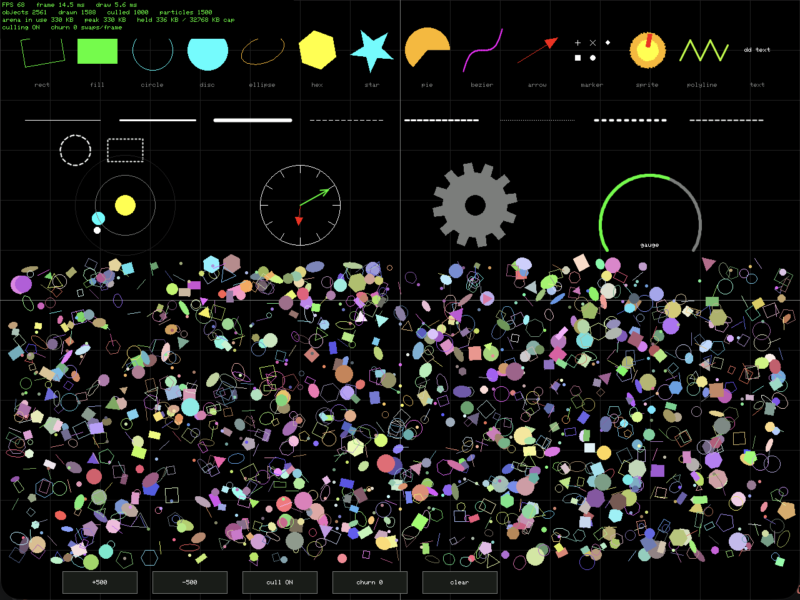

# dd

**2D vector scenes, geometry and collision for [LovyanGFX](https://github.com/lovyan03/LovyanGFX)** on ESP32 / RP2040-class microcontrollers and on the desktop (SDL).

dd lets you describe a picture as objects (circles, lines, polygons, arcs, curves, sprites, groups ...), move and animate those objects by changing their properties, and draw the
whole thing with one call. It also answers geometric questions about them: *what is under my finger, do these two shapes touch, where exactly, how far apart are they?*

It is built for small processors:

- **Float-only maths** (no `double`), so it is fast on FPUs that only do single precision.
- **No heap churn while drawing.** Objects live in a capped arena (PSRAM-first on ESP32); a per-frame scene is rebuilt without a single `malloc`.
- **Header-only**, no RTTI or exceptions required.
- **Culling** skips everything that is off-screen, and hidden objects cost nothing.

## Where to start

| If you want to ... | Read |
|---|---|
| Get something on screen in a few minutes | [Getting started](Getting-Started) |
| Understand how the pieces fit (coordinates, transforms, scene, memory) | [Concepts](Concepts) |
| Test whether shapes touch, find contact points, measure distances | [Collision guide](Collision-Guide) |
| Make it fast / fit it in RAM | [Performance and memory](Performance-and-Memory) |
| Work out why something is not drawn, or crashes | [Troubleshooting](Troubleshooting) |
| Look up a class or function | [API reference](API-Index) |

## The pieces

| Layer | Headers | Purpose |
|---|---|---|
| Maths | [ddPoint.h](API-ddPoint), [ddGeom.h](API-ddGeom), [ddShapeSet.h](API-ddShapeSet) | Points, matrices, transforms; line / circle / box collision and measurement. No graphics needed. |
| Memory | [ddArena.h](API-ddArena) | The arena allocator that holds every scene object. |
| Drawing | [ddRender.h](API-ddRender) | World to screen mapping, pens, polygon fill, culling statistics. |
| Scene | [ddVector.h](API-ddVector) | The primitives and the `RenderBlock` scene that holds, draws and picks them. |
| Collision | [ddCollide.h](API-ddCollide) | Shape-to-shape overlap, contacts and scene queries. |
| Input | [ddInteract.h](API-ddInteract), [ddSDLInput.h](API-ddSDLInput) | Select / drag / tap; correct mouse mapping on the desktop. |

## Status

Developed and tested on macOS with the SDL panel (about 20,000 automated checks, plus visual and live-mouse checks of the demo).
The ESP32 code paths (PSRAM-first arena, Arduino timing) are written but **have not been run on hardware yet**. 3D is planned and not started.
